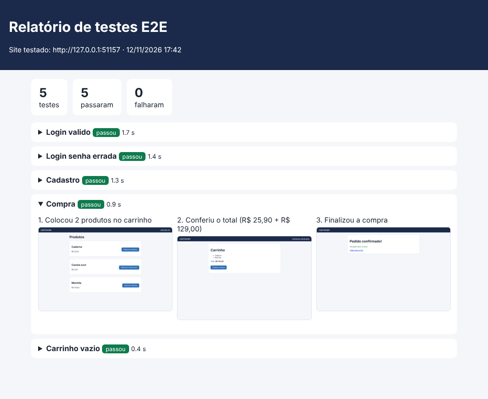

# Kit de testes E2E com Playwright


Testes automáticos de ponta a ponta (E2E) para os fluxos que mais quebram num site: **login, cadastro e compra**.
Cada passo tira um print, e no fim sai um **relatório em HTML** mostrando o que passou e o que falhou.

Roda no meu computador e também sozinho no **GitHub Actions** a cada `push`.



## O que é testado

| Teste | O que confere |
|---|---|
| Login válido | Entra com e-mail e senha certos e chega na lista de produtos |
| Login com senha errada | Mostra a mensagem de erro e não deixa entrar |
| Cadastro | Barra senha curta, cria a conta e entra com a conta nova |
| Compra completa | Adiciona 2 produtos, confere o total (R$ 154,90) e finaliza o pedido |
| Carrinho vazio | Não deixa finalizar uma compra sem produtos |

O site testado é uma lojinha de exemplo que fica na pasta `site_exemplo/`. O próprio script sobe ela numa porta local, então os testes rodam sem internet e sem depender de site de ninguém.

## Como rodar

```bash
pip install -r requirements.txt
python -m playwright install chromium

python rodar_testes.py            # menu para escolher o teste
python rodar_testes.py --todos    # roda todos sem perguntar
python rodar_testes.py --todos --mostrar   # abre o navegador para ver os testes acontecendo
```

O relatório fica em `resultados/relatorio.html`. Se algum teste falhar, o script termina com erro (código 1), e é isso que faz o GitHub Actions ficar vermelho.

## Como está organizado

```
funcoes.py        # sobe o site, abre o navegador, os testes e o relatório
rodar_testes.py   # menu e execução
site_exemplo/     # lojinha usada nos testes (HTML + JS puro)
.github/workflows/testes.yml   # roda tudo no GitHub a cada push
```

Os testes usam os seletores recomendados pelo Playwright (`get_by_role`, `get_by_label`), que procuram os elementos pelo que o usuário vê na tela. Assim o teste não quebra quando muda uma classe CSS.

## Para testar outro site

Troque a URL em `rodar_testes.py` e ajuste os textos dos campos e botões em `funcoes.py` (por exemplo `get_by_label("E-mail")`). Cada teste é uma função que recebe a página e a URL e devolve um `Teste` com os passos.

---

Feito por **Pedro Henrique** · QA · [LinkedIn](https://www.linkedin.com/in/pedro-henrique-eduardo)
